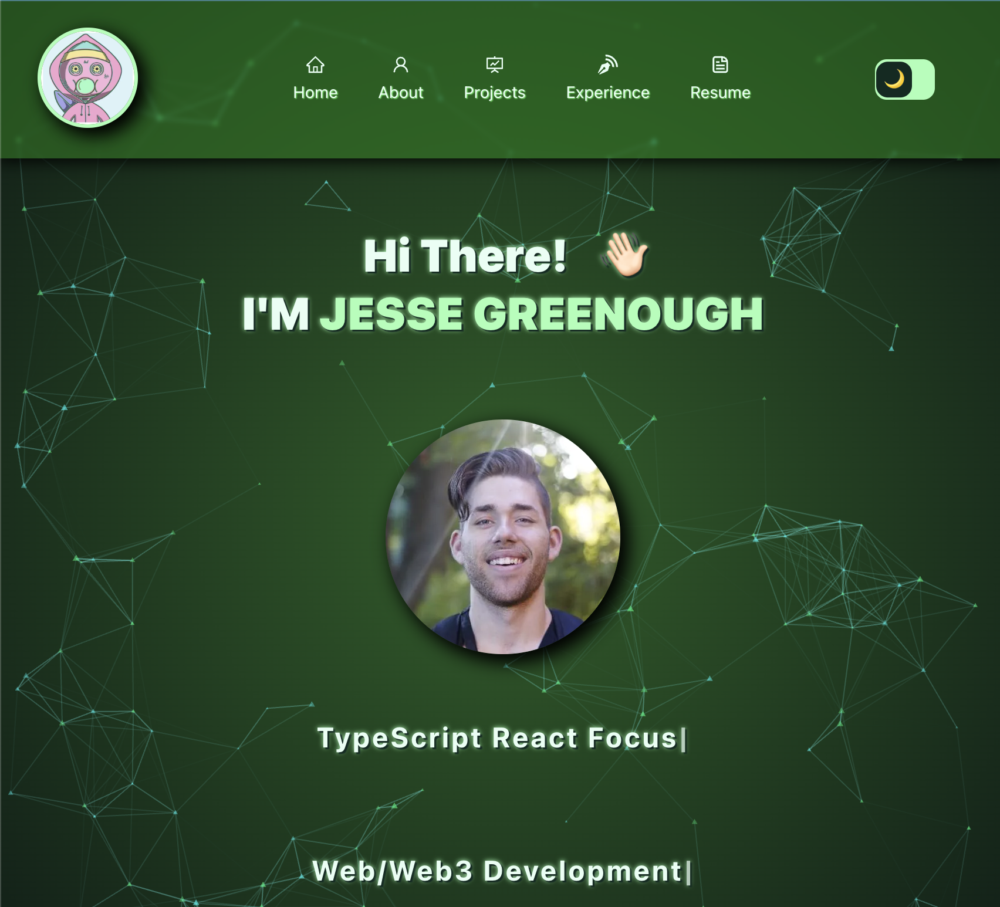

# My Personal Portfolio

<br/>
My personalized portfolio is a captivating showcase of my professional journey. It serves as a living testament to my accomplishments and experiences from my educational background to my practical experiences. With a user-friendly interface and engaging visuals, my portfolio invites viewers to delve into the realm of my professional growth and discover the innovative solutions I have created. 

<br/>
<br/>

<p align="center">

</p>

<br/>

Whether you're an employer, a colleague, or simply someone curious about my work, my portfolio offers an authentic and personalized representation of my journey in the software development industry.

This application utilizes:
- A NextJS serverless application architecture written in TypeScript with NodeJS. 
- A front-end that utilizes ReactJS, CSS modules, styled components, and other component libraries for design. 
- Personal data stored and maintained in separate collections on a MongoDB Atlas cluster with server-side rendering and serverless RESTApi function to request and paginate resource assets.
- The Cypress testing framework for component and E2E testing.
- A GitHub CI/CD pipeline with Vercel to test code and deployment success for all main branch changes against production.
- Docker containerization for functional testing of production environments

## 💻 Local Development

*** A [.env file]() and a [MongoDB connection]() (or its replacement/removal) will be required to functionally run the application ***

To run this application locally, you need to:

**1.** [Clone](https://docs.github.com/en/repositories/creating-and-managing-repositories/cloning-a-repository) the code from this repository to your local maching: 
(Do this from the directory you want the project located)
```
git clone https://github.com/GreenJ84/JesseGreenoughPortfolio.git
```

**2.** Enter the new project folder:
```
cd JesseGreenoughPortfolio
```
<hr/>
<details>
  <summary style="color: lightyellow; font-weight: 900; letter-spacing: 2px;">Are you building this for your own personal porfolio?</summary>
  <br/>
  <p style="color: lightsalmon; font-weight: 900; letter-spacing: 2px;">This is the best time to make some changes for that</p>
  
  **1.** Remove git tracking for the entire folder and cd out
  
  ```rm -rf .git && cd ..```
  
  **2.** Rename the project folder
  
  Either with your IDE UI or from the termial ```mv ./JesseGreenoughPortfolio ./<newProjectName>```
  
  **3.** Enter your project and Initialize Git
  
  ``` cd <newProjectName> && git init ```
  
  **4.** [Create your own repository through your GitHub](https://docs.github.com/en/get-started/quickstart/create-a-repo?tool=webui) or publish it to GitHub through an Git GUI like [GitKraken](https://www.gitkraken.com/)
</details>
<hr/>
<br/>
<br/>

**3.** Install all application dependencies:
```
npm install
yarn install
pnpm install
```

**4.** Run the development start script:
```
npm run dev
```

This will start the development application using NextJS scripts and you will be able to access it at http://localhost:3000 (Note: If you intend to contribute to this project, plese first view the [Contribution Guide](https://github.com/GreenJ84/GreenJ84/blob/main/profile_contributions.md.md#profile-contributions-guidline))

## 🌍 Deployment

*** A [.env file]() and a [MongoDB connection]() (or its replacement/removal) will be required to functionally run the application ***

Once you have a the application working and testing as expected, you can deploy your application with easy using Vercel.

**1.** Build the application locally
- Build the NextJS application
```
npm run build
```

**2.** Inspect the build output and bundle sizes
Look for bundle optimization, code reductions, performance limitations

**3.** Start the production application locally
```
npm run start
```

**4.** Inspect the application in production
Styling inconsistancies, unflagged build errors, production security or networking errors, performance / load balance testing

**5.** Deply to [Vercel](https://vercel.com/docs/concepts/deployments/overview) services for free, with an amazing CI/CD already implemented and ease of mind for the devloper (YOU!).


## 🤗 Contributing

Contributions are welcome! 

Please refer to my profile [Code of Conduct](https://github.com/GreenJ84/GreenJ84/blob/main/profile_code_of_conduct.md#contributor-code-of-conduct) for before contributing to this project.

My [Contribution Guide](https://github.com/GreenJ84/GreenJ84/blob/main/profile_contributions.md.md#profile-contributions-guidline) has more details on how to Get Started contrubitung

 Feel free to at any time [open an issue](https://github.com/GreenJ84/github-readme-streak-typescript/issues/new/choose) or submit a [pull request](https://github.com/GreenJ84/github-readme-streak-typescript/compare) if you have a way to improve this project.

Make sure your request is meaningful, thought out and you have tested the app locally before submitting a pull request.

## 🙋‍♂️ Support

💙 If you like this project, give it a ⭐ and share it with friends!

<p align="left">
  <a href="https://github.com/sponsors/GreenJ84">
    
  </a>
</p>

<!-- [☕ Buy me a coffee]() -->

---
Made with TypeScript, NextJS, Vercel, MongoDB Atlas and ❤️‍🔥

<a href="https://vercel.com/"></a>

## Project checks and database startup

Run `npm run typecheck` to check all application source files and the separate
Cypress configuration/suite. Run `npm run lint` for Next.js lint checks and `npm run test:startup` for isolated
database startup regression tests (no database required).

Application startup does not run database migrations or close the shared MongoDB
client. Development reuses the client across hot reloads. Set `DB_CONN_STRING` to
select a database; development defaults to `mongodb://localhost:27017` when unset,
and production requires an explicit connection string.

Primary work records use `work`; secondary work records retain the existing
`secondaryExperience` collection. No work data is moved during startup.

The education migration helper is dormant and must not be imported into startup
code. Legacy migration scripts are manual tools, not application entry points;
review them and back up data before running them. Migration tooling hardening
is separate from the startup stabilization change.

`npm run build` prerenders database-backed portfolio pages, so the configured
MongoDB server must be reachable during a production build.

## Security checks

Run `npm test` for startup and security regression tests, or `npm run test:security`
for security tests alone. These use isolated database/mail boundaries and send no
real email or database writes. See [security configuration](docs/SECURITY.md) for
required credentials, session behavior, rate limits, and deployment requirements.

## Supported framework and toolchain

Use Node 22.23.5 (`nvm use`) and `npm ci` with the committed lockfile. The application
uses Next.js 16.4.6, React 19, TypeScript 5.9, and ESLint 9. Webpack is selected
explicitly for the existing bundle analyzer and asset pipeline. `npm run lint` now
uses ESLint directly. Cypress 16 public test flags use `Cypress.expose()` and
`npm run cypress:full` passes `--expose FULL_SPECTRUM=true`.

The upgrade awaits request cookies/headers, uses `updateTag` for immediate
Server Action cache invalidation, and adopts the Next.js `proxy.ts` convention.
MongoDB 6 result metadata is requested explicitly for the shared rate limiter.
The registry audit on November 21, 2026 reported zero advisories after the upgrade
(down from 46); rerun `npm audit` as new advisories are published.

Sources: [Next.js 16 migration guide](https://nextjs.org/docs/app/guides/upgrading/version-16),
[Cypress environment migration](https://docs.cypress.io/app/guides/environment-variables).

## Reproducible container builds

The Dockerfile pins Node 22.23.5 by image digest, installs the lockfile with `npm ci`,
and ships only Next.js standalone output, static assets, and root `public` files.
The runtime runs as the unprivileged `node` user. Keep the image digest updated
when taking future Node/base-image security patches.

Portfolio pages are prerendered, so build-time configuration must point to a
reachable database containing valid portfolio data. Give the builder read-only
portfolio credentials. Supply that configuration through a BuildKit secret:

```sh
docker build --secret id=build_env,src=/secure/path/build.env -t portfolio:local .
docker run --rm --env-file /secure/path/runtime.env -p 3000:3000 portfolio:local
```

The build secret needs `DB_CONN_STRING`, `JWT_SECRET`, `ADMIN_USERNAME`, and
`ADMIN_PASSWORD` meeting the existing requirements. Runtime configuration additionally
needs mail settings and database permissions described in `docs/SECURITY.md`.
No secret file is copied into the context or final image; traced `.env*` files are
removed from standalone output. Do not place secrets in `NEXT_PUBLIC_*` variables.
Changes to BuildKit secret contents do not automatically invalidate build caches;
use `--no-cache-filter builder` when refreshing prerendered data or build credentials.
The container health check tests HTTP readiness, not database/SMTP availability.

Sources: [Docker build secrets](https://docs.docker.com/build/building/secrets/),
[Next.js standalone output](https://nextjs.org/docs/app/api-reference/config/next-config-js/output).

The clean install currently warns that ESLint 9 is out of support. It is retained
because the current React, accessibility, and import lint plugins do not declare
ESLint 10 compatibility. The dependency scan is clean; revisit this toolchain pin
when those plugins support ESLint 10. No unsupported peer override is used.
