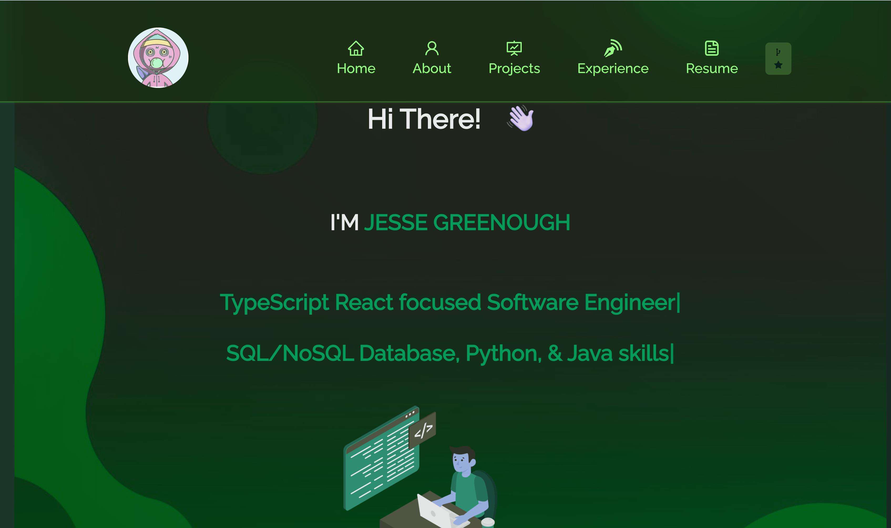

# Jesse Greenough's portfolio

I build backend software with Rust and a focus on security. I also work across TypeScript, Node.js, Python, and frontend development. This portfolio brings together projects, skills, education, experience, and resumes so someone can see both what I have built and how I approach engineering work.

The site is personal to me. I want it to show the choices behind the work, not just a list of tools. My M.S. in Cybersecurity and Information Assurance from Western Governors University (October 2025) and CompTIA SecurityX (CASP+) credential (2026) inform the security side of that work. My background in customer success and team leadership also shapes how I communicate and deliver software with other people.

[View the portfolio](https://jesse-greenough-portfolio.vercel.app/) · [Browse my GitHub](https://github.com/GreenJ84)



## Site and application

The public site has Home, About, Skills, Projects, Education, Work, and Resumes pages. Projects and credentials have searchable filters, skills have a proficiency scale, and the contact form provides a direct way to reach me. An owner-only admin area manages resources, skills, images, and operational information.

The application uses Next.js 16, React 19, TypeScript, MongoDB, CSS Modules, and Cloudinary for uploaded media. Public resource records are stored in the singular `project`, `certification`, `education`, `work`, `resume`, and `skill` collections. Home and About include authored profile content. See [architecture](docs/ARCHITECTURE.md), [security](docs/SECURITY.md), [CI checks](docs/CI_VERIFICATION.md), and [performance](docs/performance/README.md) for the implemented behavior.

## Local development

Use Node 22.23.5 and npm. Copy [.env-template](.env-template) to a project-root `.env` and replace the placeholders with local development values. Keep credentials out of Git. A local or disposable MongoDB database is needed for data-backed pages; an empty database displays empty resource lists.

```sh
npm ci
npm run dev
```

Open `http://localhost:3000`. Passkey development uses `localhost`, not `127.0.0.1`. Run the repository checks before opening a pull request:

```sh
npm run typecheck
npm run lint
npm test
npm run build
```

CI also checks routes, browser interactions, accessibility, SEO, performance, and the container image against disposable data. The migration CLI is manual and specific to this portfolio's legacy collections; it is not part of application startup or CI. Its plan, copy, and verify modes are documented in `migration/migrate-portfolio.cjs`.

## Deployment

Set database, authentication, mail, and Cloudinary values in the hosting platform's secrets or environment manager. The application reads the canonical collections, so they must contain verified records before a deployment that uses them receives traffic. Legacy collections remain for rollback until they are separately reviewed and removed. The Dockerfile provides a standalone container for container hosts and CI; Vercel builds the Next.js source directly.

## Use this architecture for another portfolio

Fork the repository and replace the authored Home and About content, images, resumes, social links, metadata, and README with your own work. Add your records through the admin UI or an import reviewed for your data model. Do not reuse this portfolio's database, credentials, passkeys, or historical skill seed. The included migration command enforces this project's legacy schema and database names; adapt it and its tests before importing a different dataset. The [environment template](.env-template) identifies required local values; keep production secrets outside the repository.

Contributions to this repository follow the [contribution guide](project_contributions.md) and [code of conduct](project_code_of_conduct.md).
